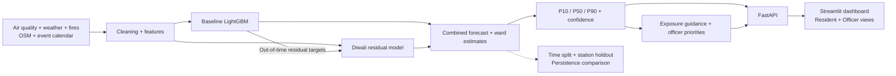

# DiwaliSense

Forecasting neighborhood air pollution around Diwali, with clear uncertainty and practical guidance.

Built for **RootAccess**, an environment and sustainability hackathon.

[Round 1 presentation: Team Clauders](output/DiwaliSense-Clauders-Round1.pptx) — five slides with speaker notes, following the supplied template.

**Status: Round 2 working historical MVP.** The React website connects to a trained LightGBM background + event-residual model through FastAPI. It replays six-hour-ahead predictions on the 2025 holdout, using 2024 training/calibration data. Real measured comparisons and 39 station-holdout results are recorded in [docs/measured_metrics.json](docs/measured_metrics.json). This is not a live forecast or a validated ward model. See [Round 2 runbook and pitch draft](docs/round2.md).

## The problem

Pollution around Diwali depends on existing emissions, weather, regional smoke, traffic, and firecracker activity. Residents and authorities need advance warning about when pollution may rise and how long it may remain high. Monitoring stations provide measurements, but most neighborhoods do not have a sensor. DiwaliSense aims to forecast PM2.5 before, during, and after Diwali while showing where the evidence is weak.

## Why existing AQI apps fall short

AQI apps help people check reported air quality, and some provide forecasts. Our focus is a combined view of background pollution, a Diwali-associated increase, neighborhood uncertainty, and local priorities. We do not claim that every existing app lacks these features or that our approach is a research first.

## Our solution: two parts of the forecast

Think of pollution as water in a bucket: background emissions fill it, festival activity adds another splash, and ventilation affects how quickly it empties.

1. **Baseline:** LightGBM estimates background PM2.5 using recent pollution, temperature, humidity, wind, boundary layer height, seasonal patterns, and regional fire detections. Boundary layer height describes how high near-surface air can mix; wind multiplied by this height gives a ventilation index.
2. **Diwali burst:** A pooled event model learns the difference between observed PM2.5 and an out-of-time baseline prediction. Planned inputs include event timing, ventilation, pre-event pollution, and documented cracker restrictions.
3. **Spatial estimates:** A planned layer combines station forecasts, interpolation, and road/land-use features to estimate ward conditions.

The burst is an **event-associated residual**, not proof of pollution caused solely by firecrackers. Unmeasured emissions and baseline errors can contribute to it.

## Key features

| Feature | Current status and purpose |
|---|---|
| Baseline forecast | Trained on non-event 2024 records for six-hour-ahead historical prediction. |
| Burst model | Trained on 2024 event residuals from a pre-October baseline; only one independent training Diwali. |
| Ward estimates | TODO: interpolation, spatial features, and station-holdout evaluation. |
| Uncertainty | Quantile estimates with December 2024 interval expansion; measured Diwali coverage is weak (51.9%). |
| Action layer | Officer view ranks station-area estimates for human review. Health advice and safe cracker-use windows are not provided. |
| API and dashboard | FastAPI serves real model output to the React replay dashboard. Streamlit remains a placeholder. |

Future map values must distinguish **measurements**, **station forecasts**, and **ward estimates**. No time window will be described as safe for bursting crackers. Guidance will not override restrictions or provide medical instructions. Municipal rankings require human review and do not prove intervention effectiveness.

## What's new / uniqueness

- Separate background and event-associated pollution to make forecasts easier to explain and test.
- Pool scarce Diwali examples across stations while acknowledging shared weather and festival conditions.
- Show neighborhood estimates with sensor coverage, freshness, and uncertainty.
- Connect forecasts to resident guidance and officer priorities without claiming medical certainty.

These are design choices, not claims of scientific novelty.

## System architecture

See [docs/architecture.md](docs/architecture.md) for the full layered diagram, mentor walkthrough, and simplified pitch version.



## Data sources

Access routes are documented below. Authenticated downloads and complete Delhi-NCR coverage for 2017–2025 have **not** been verified.

| Source | What we use it for | Access method | Free? | Known limitations |
|---|---|---|---|---|
| [OpenAQ v3](https://docs.openaq.org/) | Station PM2.5 and metadata | REST API; `OPENAQ_API_KEY` | Free key, subject to limits and provider terms | Coverage differs by year/station. Preserve flags and units; deduplicate overlapping CPCB records. |
| [CPCB](https://cpcb.nic.in/) | Official station observations | Public CCR portal and available exports; adapter TODO | Public viewing; export route must be checked | Do not assume an unrestricted historical API or complete hourly history. |
| [Kaggle fallback](https://www.kaggle.com/datasets/rohanrao/air-quality-data-in-india) | Early historical experiments | Dataset download; account may be required | Subject to dataset terms | Common release covers 2015–2020; cannot support a 2025 holdout alone. Check hourly/daily resolution. |
| [Open-Meteo](https://open-meteo.com/en/docs/historical-weather-api) | Temperature, humidity, wind, mixing height | Archive API; forecast adapter TODO | Free eligible non-commercial use within limits; attribution required | Grid estimates; variable availability depends on model/date. Reanalysis is not an issued forecast. |
| [NASA FIRMS](https://firms.modaps.eosdis.nasa.gov/api/area) | Regional fire-detection counts | Area API; `FIRMS_MAP_KEY` | Free key within limits | Detections are not unique fires or confirmed crop burning. Check historical product coverage. |
| [OpenStreetMap](https://wiki.openstreetmap.org/wiki/Overpass_API) | Roads, land use, markets | Overpass queries; adapter TODO | Public instances generally need no key | Shared servers can throttle; mapping is incomplete. Road density is not live traffic. ODbL obligations apply. |
| Verified ward boundaries / optional population | Ward aggregation and context | Documented local files; TODO | Source/license to be confirmed | Record boundary version and population year; do not invent missing values. |
| Diwali / cracker-ban calendar | Event alignment and policy context | Manual table with source links; TODO | Public records where available | Restrictions vary by location/year and do not measure compliance. |

## Tech stack

| Layer | Technology | Purpose |
|---|---|---|
| Data | Python, pandas | Ingestion, cleaning, hourly features |
| Models | LightGBM | Baseline and event residual quantiles |
| Validation | scikit-learn, pytest | Planned metrics and current smoke tests |
| Spatial | GeoPandas | Planned joins and ward estimates |
| Backend | FastAPI, Uvicorn | Forecast endpoint |
| Frontend | React, Vite, TypeScript, Tailwind | Historical replay, uncertainty chart, resident/officer views; Streamlit remains a scaffold |
| Storage | Local CSV / GeoJSON / artifacts | Offline demo and reproducible inputs |
| Collaboration | Git, GitHub, Mermaid | Source control and architecture |

## Validation plan

- **Time split:** train through 2024; tune on earlier rolling time folds; keep Diwali 2025 untouched for final evaluation. Target history is 2017–2025, subject to coverage.
- **Station holdout:** the current 39-station experiment excludes each station from fitting and calibration, but uses that station’s prior sensor readings at inference. This measures station transfer with observations; it does **not** validate unsensored wards. A future spatial experiment must also exclude held-out sensor inputs.
- **Persistence baseline:** carry the latest available PM2.5 forward; compare identical horizons and evaluation records.
- **Leakage control:** use only information available at forecast issue time, including reporting delays. Fit cleaning/imputation on training data. Build burst targets from out-of-time baseline predictions.
- **Weather distinction:** label reanalysis-based experiments retrospective; use archived issued forecasts for operational evaluation when available.
- **Metrics:** MAE and RMSE in µg/m³; PM2.5 sub-index category accuracy using documented CPCB 24-hour averaging/completeness rules. This is not full multi-pollutant AQI accuracy.
- **Uncertainty:** report quantile loss, interval coverage, width, and sample counts. Adding component quantiles does not automatically produce valid total ranges.

Current replay: Jan–Nov 2024 fitting, December 2024 interval calibration, 2025 test. Six hours before the target hour starts; issue times assume source bins are available at their recorded end. Same test records and horizon for each comparison.

| Evaluation | Rows | MAE (µg/m³) | RMSE (µg/m³) |
|---|---|---|---|
| Persistence, all 2025 test times | 50,010 | 43.819 | 71.830 |
| Baseline + burst, all 2025 test times | 50,010 | 28.365 | 48.063 |
| Persistence, Diwali 2025 event window | 389 | 148.319 | 208.602 |
| Baseline only, Diwali 2025 event window | 389 | 81.491 | 135.977 |
| Baseline + burst, Diwali 2025 event window | 389 | 86.409 | 125.418 |

The combined model improves on persistence in this replay. The burst component has **worse Diwali MAE** than the baseline alone, so it is experimental. Expanded interval coverage is **88.45% overall**, but only **51.93% during the event window**; do not describe the event range as reliable. Event window: 24 hours before to 48 hours after 18:00 IST on Diwali. Many station rows represent the same festival, not independent Diwalis.

**AQI-category accuracy: [TO BE MEASURED].** The model predicts hourly PM2.5, so a valid 24-hour AQI-category evaluation is not implemented. Per-station holdout results are in `docs/measured_metrics.json`.

## Known limitations and honest risks

- Most wards have no sensor; a detailed map does not create detailed ground truth.
- Complete 2017–2025 history provides nine annual Diwali events; stations do not create more independent festivals.
- Daily records cannot establish hourly peaks or time windows.
- Cracker bans, enforcement, behavior, emissions, and weather shift between years.
- Baseline errors and unmeasured emissions affect the burst residual.
- Fire counts and road density are imperfect proxies; live traffic is not implemented.
- Quantile reliability and spatial uncertainty must be measured; station intervals do not automatically cover ward errors.
- Cached inputs become stale; the UI must show data dates and demo status.
- This prototype does not establish the effectiveness of sprinklers, patrols, or other interventions.

## Scaling roadmap

**Delhi-NCR pilot → additional cities → state coverage → national coverage.**

Start with a limited set of stations and wards, audit coverage, and measure performance. Add cities after local evaluation; standardize ingestion and scheduled outputs at state scale. National coverage requires regional calibration, scalable storage, and independent evaluation. A Delhi-trained model is not assumed to transfer unchanged.

## How to run locally

Use Python 3.11 or 3.12. On macOS, LightGBM may require `brew install libomp`.

```bash
git clone https://github.com/adityadhariwal007/diwalisense.git
cd diwalisense
python3.11 -m venv .venv
source .venv/bin/activate
# Windows PowerShell: .venv\Scripts\Activate.ps1
python -m pip install -r requirements.txt
cp .env.example .env
```

Set `OPENAQ_API_KEY` and `FIRMS_MAP_KEY` in `.env`. Never commit credentials or unapproved datasets. Open-Meteo's free non-commercial endpoint needs no key.

```bash
python -m pytest -q
python -m uvicorn api.main:app --reload
```

In another terminal:

```bash
source .venv/bin/activate
python -m streamlit run app/dashboard.py
```

API docs: <http://127.0.0.1:8000/docs>. Dashboard: <http://localhost:8501>.

### React website

The cinematic landing page lives in `frontend/` and uses React, Vite, TypeScript,
and Tailwind CSS. Use Node.js 22.12+ or a supported newer version:

```bash
cd frontend
npm ci
npm run dev
```

Open the local URL printed by Vite; opening `frontend/index.html` directly will
not run the app. For production output, run `npm run build`; `npm test` checks
the video fade boundaries.

The page adapts the supplied cinematic reference to DiwaliSense. Its navigation
and forecast CTA open accessible panels. The forecast panel connects to FastAPI
for historical predictions, uncertainty, measured validation, and station priorities.
Run the Python API on port 8000 alongside Vite for development.
The supplied nature video, fallback image, and fonts are bundled locally for
offline use after dependencies are installed. Motion can be paused and respects
the device's reduced-motion setting. The video uses a manual fade loop, with a
100 ms restart delay. Lenis and GSAP downloads remain in `app/static/vendor/`;
this single-screen page uses CSS transitions rather than adding scroll libraries.
The supplied video remains a third-party asset; redistribution rights have not
been verified.

`GET /forecast?station=site_5024&date=2025-10-20&hour=23` returns trained-model output, marked `is_dummy: false` and `is_live: false`. Run `python -m src.models.hourly` once after installing dependencies. React is the connected dashboard; Streamlit remains a placeholder. Read `docs/round2.md` for the complete offline demo setup.

Code is organized under `src/ingestion/`, `src/features/`, `src/models/`, `src/spatial/`, `src/actions/`, and `src/validation/`. Data belongs in `data/raw/` and `data/processed/`, with generated model outputs in `artifacts/`. Spatial, action, and validation packages contain TODOs. Download dependencies and inputs before the offline event; local map geometry and cached forecast display remain TODO.

### Current checks

Ten Python checks pass, including feature availability, gap handling, trained-model responses and invalid inputs. The frontend build and video-loop unit test pass. LightGBM now loads after installing `libomp`. Model performance comes from the measured historical holdouts above, not the smoke tests. Live reporting latency, operational forecasts, unsensored wards and AQI evaluation remain unverified.

## 48-hour roadmap

### Round 1 — first 2 hours

- [x] Draft README, architecture, data risks, and validation plan.
- [x] Prepare ingestion, feature, model, API, and dashboard scaffold.
- [x] Create the GitHub repository and push the submission files.
- [ ] Audit actual data access and coverage; assign team responsibilities.

### Round 2 — hours 2–32

- [ ] Cache usable station and weather data; review units, flags, and gaps.
- [x] Implement persistence, then train and evaluate the baseline.
- [x] Train an experimental 2024 event-residual model; record its mixed results.
- [x] Evaluate intervals and 39 station holdouts; record measured metrics.
- [x] Connect the React dashboard to the trained-model API.
- [ ] Implement and validate ward estimates.
- [ ] Verify offline operation and missing-data behavior.

### Round 3 — hours 32–48

- [ ] Freeze a reproducible demo version and cached backup.
- [ ] Show measured comparisons, local uncertainty, and known failures.
- [ ] Rehearse the pitch and tag the submitted version.

If coverage cannot support the burst model or 2025 test, demonstrate the validated subset and state what is incomplete.

## Team

**Team Clauders:** Aditya, Maanvik, Palakshi, and Manveer.

Roles will be assigned by the team.

## License

Project code is released under the [MIT License](LICENSE). External datasets, maps, and service outputs retain their own licenses and attribution requirements.
