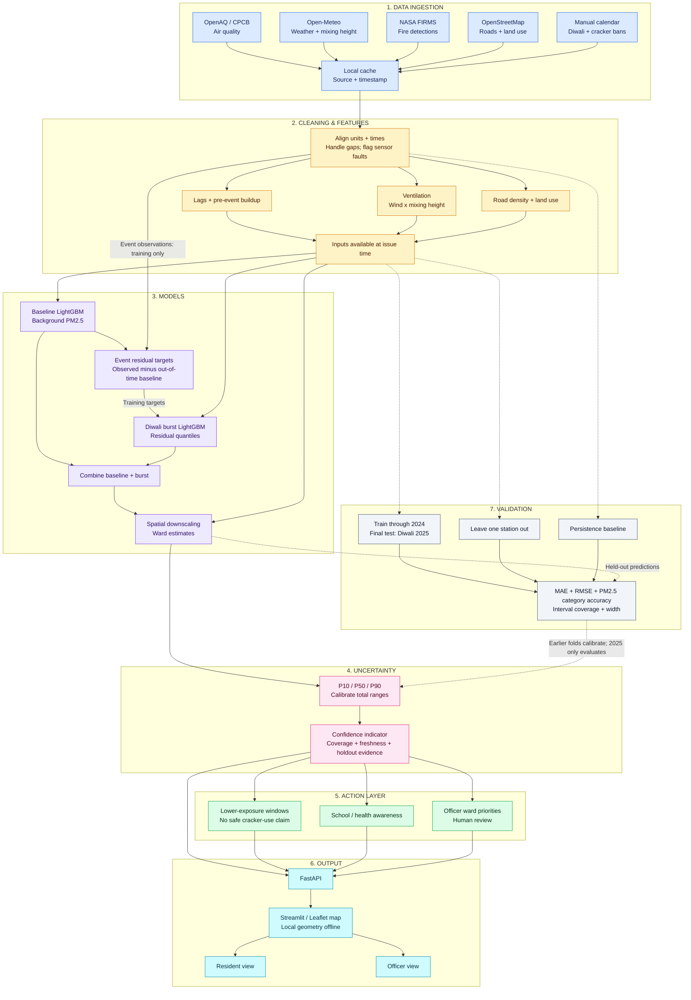

# System architecture

Planned architecture; implementation status is documented in the README.

## Mentor walkthrough

1. Collect pollution, weather, fires, map features, and policy dates; cache inputs for offline use.
2. Clean records and calculate recent pollution buildup, ventilation, and spatial context.
3. Predict background pollution and an additional event-associated residual, then estimate ward conditions.
4. Attach uncertainty and data-quality indicators before producing guidance and officer priorities.
5. Serve resident and officer views; compare held-out forecasts against persistence.

## Pitch slide: 10 boxes

```mermaid
flowchart LR
    subgraph ING["INGESTION"]
        DATA["Air + weather + fires<br/>OSM + festival calendar"]
    end
    subgraph FE["FEATURES"]
        FEATURES["Clean + lags + ventilation<br/>Buildup + spatial context"]
    end
    subgraph MOD["MODELS"]
        BASE["Baseline LightGBM"]
        BURST["Diwali residual quantiles"]
        WARDS["Combine + estimate wards"]
    end
    subgraph UNC["UNCERTAINTY"]
        RANGE["P10 / P50 / P90<br/>Calibrate + report confidence"]
    end
    subgraph ACT["ACTIONS"]
        ACTION["Exposure windows<br/>Advisories + priorities"]
    end
    subgraph OUT["OUTPUT"]
        API["FastAPI"]
        DASH["Dashboard<br/>Resident + Officer"]
    end
    subgraph VAL["VALIDATION"]
        TEST["Time split + station holdout<br/>Compare persistence"]
    end
    DATA --> FEATURES
    FEATURES --> BASE
    FEATURES --> BURST
    BASE -->|"Out-of-time residuals for training"| BURST
    BASE --> WARDS
    BURST --> WARDS
    FEATURES --> WARDS
    WARDS --> RANGE
    RANGE --> ACTION
    RANGE --> API
    ACTION --> API
    API --> DASH
    FEATURES -.-> TEST
    WARDS -.-> TEST
    classDef ingestion fill:#DBEAFE,stroke:#2563EB,color:#172554;
    classDef features fill:#FEF3C7,stroke:#D97706,color:#451A03;
    classDef models fill:#EDE9FE,stroke:#7C3AED,color:#2E1065;
    classDef uncertainty fill:#FCE7F3,stroke:#DB2777,color:#500724;
    classDef actions fill:#DCFCE7,stroke:#16A34A,color:#052E16;
    classDef output fill:#CFFAFE,stroke:#0891B2,color:#083344;
    classDef validation fill:#F1F5F9,stroke:#475569,color:#0F172A;
    class DATA ingestion;
    class FEATURES features;
    class BASE,BURST,WARDS models;
    class RANGE uncertainty;
    class ACTION actions;
    class API,DASH output;
    class TEST validation;
```

Ward values are estimates, not measurements. Burst residuals are not causal source attribution. Quantile coverage and spatial uncertainty require validation. Results: [TO BE MEASURED].
